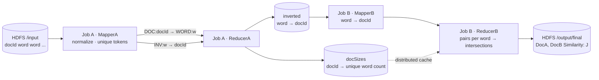

# Hadoop MapReduce Document Similarity

Computes pairwise **Jaccard similarity** between documents with a two-stage **Hadoop MapReduce** pipeline in Java (an inverted index followed by pair aggregation), run on a **Dockerized Hadoop cluster** and benchmarked on 1 vs. 3 datanodes.


## Problem

Finding near-duplicate or related documents (plagiarism checks, deduplication, recommendations) means comparing every pair of documents. That's quadratic, and it doesn't fit on one machine at scale. This project solves it the MapReduce way: build an **inverted index** so only documents that share at least one word are ever compared, then aggregate overlaps in parallel.

$$J(A,B) = \frac{|A \cap B|}{|A \cup B|} = \frac{|A \cap B|}{|A| + |B| - |A \cap B|}$$

## Architecture



## Tech stack

| Area | Tools |
|---|---|
| Processing | Java, Hadoop MapReduce (`MultipleOutputs`, distributed cache), HDFS |
| Build | Maven |
| Cluster | Docker Compose Hadoop 3.3 cluster: namenode, resourcemanager, nodemanager, historyserver, datanode(s) |

## How it works

- **Job A, MapperA:** lowercases each document, strips non-alphanumerics, and emits each **unique** token twice: `DOC:<docId> → WORD:<w>` (for document size) and `INV:<w> → <docId>` (for the inverted index).
- **Job A, ReducerA:** routes by key prefix with `MultipleOutputs`. It writes `docSizes` (unique-word count per document) and `inverted` (`word → docId`).
- **Job B, MapperB:** reads the inverted index and emits `word → docId`.
- **Job B, ReducerB:** for each word, generates every document pair that shares it and accumulates the intersection counts. In `cleanup()` it loads `docSizes` from the distributed cache and emits the Jaccard score for each pair.

## How to run

**Prerequisites:** Docker, Maven, Java 8+.

```bash
docker compose up -d                                   # single-datanode cluster (add datanodes for the 3-node run)
mvn clean package -DskipTests                          # build the job JAR

docker cp target/DocumentSimilarity-0.0.1-SNAPSHOT.jar namenode:/DocumentSimilarity.jar
docker exec -it namenode hdfs dfs -rm -r -f /input /output
docker exec -it namenode hdfs dfs -mkdir /input
docker cp dataset/ds1.txt namenode:/ds1.txt
docker exec -it namenode hdfs dfs -put /ds1.txt /input

docker exec -it namenode hadoop jar /DocumentSimilarity.jar \
  com.example.controller.DocumentSimilarityDriver /input /output
docker exec -it namenode hdfs dfs -cat /output/final/part-r-00000
```

## Results

Output for `dataset/ds1.txt`. The 3-datanode run ([`output/results_ds1.txt`](output/results_ds1.txt)) and the single-node run ([`output/single_node_output.txt`](output/single_node_output.txt)) give identical results:

```
Document2, Document3 Similarity: 0.94
Document1, Document2 Similarity: 0.01
Document1, Document3 Similarity: 0.01
```

| Cluster | Execution time |
|---|---|
| **3 datanodes** | **13 s** |
| 1 datanode | 24 s |

Spreading the work over 3 datanodes made the job **~1.8× faster** while producing the same output.

## Challenges & fixes

- **ReducerB crashed parsing non-integer values:** document sizes are now loaded from the `docSizes` named output through the distributed cache, and malformed lines are skipped.
- **"Output directory already exists":** `/input` and `/output` are cleared before each run.
- **Results trapped in HDFS:** copied out with `hdfs dfs -get` plus `docker cp`.
- **Design trade-off:** ReducerB keeps pair intersections in memory and emits them in `cleanup()`, so the driver pins Job B to one reducer (`setNumReduceTasks(1)`). A third aggregation stage keyed by document pair would let Job B scale out across reducers.

## Screenshots

Not applicable: this is a batch job with text output, shown above.

## Repo structure

```
.
├── src/main/java/com/example/
│   ├── DocumentSimilarityMapper.java          # MapperA, MapperB
│   ├── DocumentSimilarityReducer.java         # ReducerA, ReducerB
│   └── controller/DocumentSimilarityDriver.java
├── dataset/ds1.txt
├── output/                                    # 3-node and 1-node results
├── docker-compose.yml, hadoop.env             # Hadoop cluster
└── pom.xml
```
